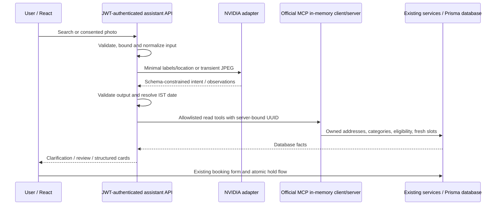

# Ask Loop: implementation and operations

Ask Loop adds a read-only waste-photo review and conversational pickup search at `/ask`. It is **disabled by default**. Discovery, authentication, holds, checkout and payments work without NVIDIA credentials. This remains a sandbox: no real pickup dispatch or money movement.

## User flow

Open **Ask Loop** from the collection screen. Describe materials, location/address label and time, or select one photo. A photo requires explicit consent to NVIDIA processing. Review visible items, correct the material checkboxes, confirm the selection and acknowledge unresolved items before searching. An image never establishes provider eligibility. Mixed/unknown items remain visible; users explicitly choose whether to continue with only their confirmed categories.

Example: `Find paper and plastic collection at Home tomorrow after 4 PM, cheapest first.` Missing or ambiguous details produce focused clarifications. Results show actual database prices in paise, dates in Asia/Kolkata and fresh slots. **Review pickup** opens the existing provider booking form with address, material, day and slot draft parameters. The form refetches availability and the existing hold transaction revalidates capacity and price. The assistant never reserves anything.

When capabilities are disabled, missing, or unavailable (including an older API deployment), the page offers manual collection search. A static browser demo also reports AI disabled. No fake AI answers are substituted.

## Components and trust boundaries



Backend files are in `backend/src/assistant/`; frontend files in `frontend/src/features/assistant/`. The official `@modelcontextprotocol/sdk` client and `McpServer` communicate over `InMemoryTransport.createLinkedPair()`. There is no public MCP endpoint, persistent agent, autonomous loop, vector store, schema change or migration.

The model interprets a strict intent schema. The orchestrator chooses the consequent tools deterministically rather than permitting arbitrary model function calls. This makes native NVIDIA function-calling support optional. There are exactly four strict, read-only MCP tools:

| Tool                      | Data and restrictions                                                                                                       |
| ------------------------- | --------------------------------------------------------------------------------------------------------------------------- |
| `get_waste_categories`    | Actual six Loop enum values; no arguments                                                                                   |
| `list_my_addresses`       | Up to 20 owned address IDs/labels/cities/postcodes; no user ID argument                                                     |
| `find_eligible_providers` | All selected materials plus owned address coverage or existing city/postcode search; server sorting; at most five providers |
| `get_available_slots`     | Only a provider and the exact preferences selected in the same request; fresh database read                                 |

User UUIDs come exclusively from verified JWTs and are closed over in each request's MCP server. The model receives labels/city/postcode, not address UUIDs, street addresses, names, telephone numbers or tool results. Users should avoid personal details in free text. A malicious user can still type personal information into their own message; it is sent to NVIDIA with that disclosure. Model text is escaped React text, never HTML or an executable URL. Guidance URLs are server-owned enums. Provider/slot identifiers, prices and timestamps are validated service outputs, never model fields.

Assistant reads use the existing provider/availability services with cleanup and metadata caching disabled. They cannot expire a hold or mutate data. Shared material/coverage predicates are reused by booking. Date offsets and time filtering run in tested server code; a model-proposed explicit date must appear in user text (or be explicitly selected in the date control). Date range: today through 31 days, IST. `after` includes its boundary; `before` excludes it.

## Configuration and model evidence

Backend environment only; never use `VITE_*` for NVIDIA settings:

```dotenv
AI_ASSISTANT_ENABLED=false
NVIDIA_API_KEY=
NVIDIA_CHAT_MODEL=deepseek-ai/deepseek-v4.1-flash
NVIDIA_VISION_MODEL=deepseek-ai/deepseek-v4.1-flash
```

The key and chat model must be present for chat capability. Photo additionally requires a vision model. Missing AI settings do not block boot or `/api/health`. All assistant endpoints require authentication:

| Endpoint                          | Contract                                                                                             |
| --------------------------------- | ---------------------------------------------------------------------------------------------------- |
| `GET /api/assistant/capabilities` | `data.enabled`, `chat`, `photo`, reason, categories and image byte limit; no secrets                 |
| `POST /api/assistant/search`      | JSON message, bounded history, optional owned address/location/date/materials and photo confirmation |
| `POST /api/assistant/photo`       | JSON `{ "consent": true, "image": "<base64 of one image>" }`; no URL or file-array support           |

The adapter uses `https://integrate.api.nvidia.com/v1/chat/completions`, `stream:false`, strict `response_format.json_schema`, and inline `image_url` JPEG data. These are candidate endpoint capabilities until the live smoke passes. Official catalog identifiers and request examples were checked against [DeepSeek V4.1 Flash](https://build.nvidia.com/deepseek-ai/deepseek-v4.1-flash), its [NVIDIA API reference](https://docs.api.nvidia.com/nim/reference/nvidia-deepseek-v4_1-flash) and [model card](https://build.nvidia.com/deepseek-ai/deepseek-v4.1-flash/modelcard). Optional candidate [DiffusionGemma 26B A4B IT](https://build.nvidia.com/google/diffusiongemma-26b-a4b-it) uses `google/diffusiongemma-26b-a4b-it`; it is not selected automatically or live-validated. Native tool support and schema reliability vary by endpoint; [NVIDIA NIM release notes](https://docs.nvidia.com/nim/large-language-models/2.1.4/about-nim-llm/release-notes.html) document relevant limitations. Catalog documentation is not proof of live endpoint compatibility. No embedding model is installed.

**Live validation status: blocked by missing NVIDIA credentials.** Deterministic mock tests do not establish model accuracy, account access, NVIDIA retention policy or endpoint feature support. Do not enable production based on mocks.

## Limits and failure handling

| Resource      | Limit                                                                                                                                    |
| ------------- | ---------------------------------------------------------------------------------------------------------------------------------------- |
| Search input  | 1,000 characters; six history entries of 500 characters; 16 KiB JSON                                                                     |
| Image         | One JPEG/PNG/WebP, 2 MiB decoded bytes; approximately 2.8 MiB JSON request                                                               |
| Decoding      | Actual magic bytes + decoded format; still image; 16–8,192 px each side; 8 million pixels; 3-second Sharp processing timeout             |
| Normalization | Orientation applied; white 768×768 canvas; JPEG re-encode; metadata stripped                                                             |
| Request       | 22 seconds including body parsing, image work, model and tools; cancellation propagates                                                  |
| Model         | At most two attempts total per request; 8.5 seconds/attempt; 1,000 output tokens; 64 KiB response envelope; 16,000 content characters    |
| Retry         | One retry for 429/502/503/504 when Retry-After is at most one second; no auth/schema retries                                             |
| MCP           | Eight calls; five-second call timeout; five provider cards, three slots/card; oversized eligible catalog (>50) requires narrowing        |
| Concurrency   | Two operations per process; one per user; no queue                                                                                       |
| Rate          | Per user: eight searches/minute, three photos/minute; per IP: 20 searches/minute, eight photos/minute; existing API limiter also applies |

The process-local limiter/concurrency budget resets on restart and is not shared across replicas. A shared limiter and admission controller are required before horizontal scaling. The ordinary availability service returns at most 100 slots per provider/day, so unusually dense schedules require narrower queries or a future service pagination change. The catalog contains broad material categories, not detailed acceptance policies. Approximate city/postal search follows existing discovery semantics; the booking form still needs an owned, exactly covered address.

Uploads are held only in bounded memory, never stored in the database/filesystem. The input buffer and normalized JPEG are overwritten when processing finishes; transient base64 strings and network copies are garbage-collected, not guaranteed secure erasure. Sharp strips EXIF/XMP/ICC metadata. Preview object URLs and event listeners are cleaned up. Cancellation invalidates UI request serials even when a transport ignores abort. Photo review tokens are user-bound HMACs with a ten-minute expiry and an unresolved-items acknowledgement requirement; they contain no image. Manually choosing categories remains possible without an image.

Errors follow the existing `{error:{code,message,requestId}}` envelope. Disabled/unconfigured (503), invalid input (400/413/415), AI auth/unavailable (503), timeout (504), throttling/busy (429), invalid model output (502), and lookup failures (503) are distinct from successful `no_providers`/`no_slots` outcomes. Foreign selected addresses return 404 before a model call. Logs contain request ID, operation, configured model identifier, latency and outcome/error category only; not prompts, conversations, images, full addresses, UUID identities, API credentials or upstream bodies. These controls constrain impact; they do not make hallucination impossible.

## Local and staging verification

Recorded verification on 2026-10-28: `npm run check` passed (64 backend tests, 34 frontend tests, lint, TypeScript and both builds); `npm run test:e2e` passed all eight browser tests, including real API/payment/navigation regressions and mocked AI desktop/mobile review. The isolated `hks-deployment-check` Neon branch passed real MCP search/ownership plus existing concurrent hold, payment, refresh and overlap checks through a local API process; its guest fixtures were removed and the local SQLite client restored. Gherkin validation compiled 211 examples. These are application/mocked-model checks, not live NVIDIA accuracy evidence. A local Vitest worker-start timeout occurred during an earlier concurrent run; the sequential full run passed without changing worker limits.

```sh
npm ci
npm run setup
npm run migrate
npm run seed
npm run check
npm run dev
```

Ordinary local access is `http://localhost:5173`. With the default disabled flag, sign in normally and open Ask Loop: the manual fallback should work. To test AI locally, put credentials in ignored `backend/.env`; keep the flag false initially. Run the opt-in live endpoint probe:

```sh
npm run assistant:smoke -- --live
```

The smoke uses synthetic text and a gray JPEG, never saved customer photos or addresses. It checks strict chat output and image schema response; optionally diagnoses native tool calling. It does **not** prove waste recognition accuracy. Missing credentials produce exit code 2 and zero model requests. A required probe failure exits 1. Keep the flag false until required probes pass.

Next set `AI_ASSISTANT_ENABLED=true` on a **staging/local** backend, restart it, and run [the evaluation set](docs/ASK_LOOP_EVALUATION.md). Use an isolated Neon branch with its own pooled `DATABASE_URL` and direct `DIRECT_DATABASE_URL`. Never run SQLite test cleanup or reseeding against hosted production. The existing Postgres verifier creates and cleans only its own guest/booking fixtures; run it against that isolated branch:

```sh
npm run neon:generate
npm run neon:migrate
npm run neon:seed
npm run neon:verify
# Restore the local client before returning to SQLite:
npm run generate -w backend
```

These Neon commands load the root `.env.local`/`.env` and backend environment. **Verify they point at the isolated branch first.** The default root file may point at production. Do not copy database URLs into logs or commits. `neon:verify` includes real MCP-to-Postgres search/ownership checks with an injected mock intent plus the existing atomic booking/payment/session checks. CI uses an isolated Postgres service and no NVIDIA key.

Manual staging checks: missing materials/location/date clarification; all-category coverage; cheapest and earliest; today/tomorrow at IST midnight; mixed and blurry image review; confirmation and correction; unsupported and off-topic prompts; network failure/retry/cancel; select a slot another session reserves and confirm normal stale-slot handling; desktop/mobile keyboard navigation; disable AI and complete an ordinary sandbox pickup. Keep separate actual outcomes for every model evaluation.

## Deployment, enablement and rollback

The existing `frontend/vercel.json` rewrites same-origin `/api/*` to Render. No new serverless function is introduced. The photo JSON limit is approximately 2.8 MiB; the API enforces it before image decoding. The backend deadline is 22 seconds; measure actual proxy upload/response timeouts on staging, including a cold Render Free wake-up, before enabling. This release has no live AI proxy timing measurement. A sleeping Free backend may time out at the proxy; the UI retains manual/retry navigation. Sharp's Linux optional binaries are in the lockfile and must remain installed by `npm ci`.

1. Run all local checks and isolated Postgres verification. Commit and push through the existing main workflow. GitHub Actions checks SQLite/frontend/builds and isolated Postgres before triggering Render with the verified SHA. Vercel's existing Git integration builds the frontend separately. Render defaults AI off; an older/newer frontend safely reads capabilities, allowing either deployment order.
2. Verify the deployed commit, `/api/health`, authenticated capabilities, ordinary discovery, session refresh and sandbox booking. `npm run cloud:verify` covers the hosted normal flow and disabled Ask Loop fallback.
3. After staging model smoke and evaluations pass, add only backend `NVIDIA_API_KEY`, `NVIDIA_CHAT_MODEL`, `NVIDIA_VISION_MODEL` in Render Environment. Do not overwrite database/JWT/payment secrets. Deploy/restart while the flag stays false; health and normal bookings must remain green.
4. Set backend `AI_ASSISTANT_ENABLED=true`, deploy/restart, authenticate and recheck capabilities. Repeat required API and browser workflows through the actual Vercel proxy. Check sanitized error/rate/latency metadata. Close Ask Loop and reopen after a flag change (capabilities cache is 30 seconds); refresh if necessary. Chat/photo must agree with backend settings. If any required check fails, disable again.
5. **Immediate rollback:** set `AI_ASSISTANT_ENABLED=false` in Render and restart/redeploy. Search/photo return controlled unavailability; normal bookings need no data repair. Capability refresh hides controls. No database rollback is needed. If reverting code, use a reviewed `git revert <feature-commit>` and the existing gated pipeline, or roll both hosts to the previous verified commit. Never reset or reseed production data to roll back this feature.

Production enablement is intentionally blocked until a real backend key and live verification are available. No paid resources or remote secrets are created by this implementation.
