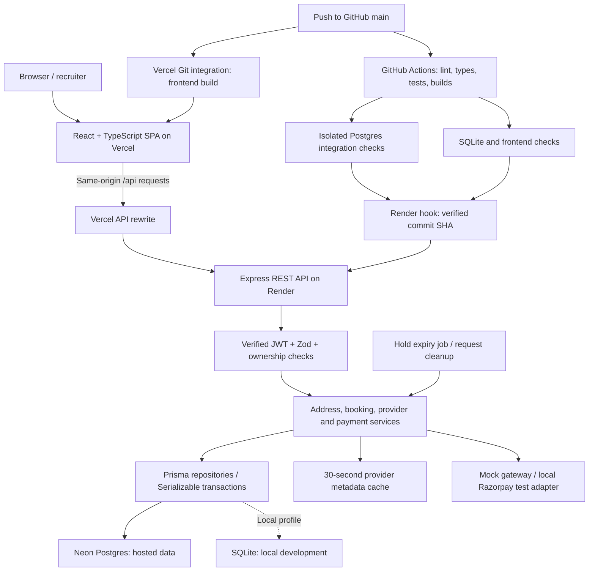

# Loop — Household Waste Pickup

**A deployed full-stack scheduling application that makes waste collection easier to book and harder to double-book.**

[Live application](https://hks-fullstack.vercel.app) · [API health](https://hks-fullstack-api-m007.onrender.com/api/health) · [Functional specification](FEATURES_GHERKIN.md) · [Deployment guide](CLOUD_DEPLOYMENT.md)

**Ask Loop:** a read-only photo review and conversational pickup search is implemented behind a backend feature flag, disabled by default. It uses an official in-process MCP client/server, server-only NVIDIA model adapter and existing booking handoff. See [configuration, verification and rollback](ASK_LOOP.md) and the [honest model evaluation record](docs/ASK_LOOP_EVALUATION.md). Live AI validation requires a configured backend NVIDIA key; ordinary manual booking remains available without it.

## Executive Summary & the Problem

Households need to find collection partners who accept their waste, serve their address, and have a suitable pickup time. Collection providers need a schedule that stays consistent when multiple people reserve the same capacity. Payment completion must agree with that schedule.

Loop connects provider discovery, saved addresses, temporary reservations, sandbox checkout, and private pickup history in one workflow. Its engineering focus is the coordination behind that workflow: transactional booking, database-enforced interval protection, verified payment settlement, and ownership checks on every private resource.

**The hosted application is a portfolio demo backed by a real API and database.** Each visitor receives an isolated guest account. Payments are simulated; there is no real SMS verification, money movement, or pickup dispatch.

## Key Technical Highlights

| Engineering concern    | Implemented approach                                                                                                                                    |
| ---------------------- | ------------------------------------------------------------------------------------------------------------------------------------------------------- |
| Concurrent booking     | Conditional `AVAILABLE → HELD` claim inside a Serializable Prisma transaction, with bounded conflict retries and per-user idempotency keys.             |
| Provider capacity      | One capacity across all service areas. Postgres exclusion constraints and SQLite triggers reject overlapping intervals, including partial overlaps.     |
| Private resources      | Verified JWT subject supplies the user UUID; address, booking, order, and payment lookups include ownership predicates. Foreign resources return 404.   |
| Session security       | Short access tokens stay in memory. Refresh tokens and OTPs are stored hashed. Refresh rotation detects replay and revokes the token family.            |
| Payment integrity      | Amounts come from the provider record, in integer paise. Settlement verifies signatures and captured order/amount/currency before confirming the slot.  |
| Historical correctness | Bookings preserve provider, address, price, time, and waste snapshots. Address edits cannot rewrite past pickup details.                                |
| Expiry and recovery    | Ten-minute default holds expire transactionally. Late captures become `REFUND_REQUIRED` without reclaiming a released slot.                             |
| Navigation correctness | Protected routes preserve intended destinations; filters and booking drafts use URL/history state; timers and listeners are cleaned up.                 |
| Delivery               | GitHub Actions checks both database profiles. Vercel deploys the frontend from GitHub; a gated Actions deploy hook sends the verified commit to Render. |

### Tech Stack

| Portion          | Technologies and responsibilities                                                                                                       |
| ---------------- | --------------------------------------------------------------------------------------------------------------------------------------- |
| Frontend         | React 19, TypeScript, Vite, React Router, TanStack Query, React Hook Form, Zod, Lucide icons, custom responsive CSS.                    |
| API              | Node.js, Express 5, TypeScript, JWT authentication, Zod validation, Helmet, configured CORS, rate-limit middleware, Pino logging.       |
| Persistence      | Prisma 6; SQLite for local development; Neon Postgres for the hosted profile. Committed migrations for each database.                   |
| Payment adapters | Explicit mock gateway; Razorpay **test-mode** adapter for local configuration, with signature/capture verification and signed webhooks. |
| Quality          | Vitest, Supertest, Testing Library, Playwright, ESLint, TypeScript checks, Prettier.                                                    |
| Hosting          | Vercel frontend and same-origin API proxy; Render Free Express service; the configured Neon project.                                    |

## System Architecture

The application is a modular monolith. HTTP routes delegate to domain services and ownership-aware repositories; Prisma handles persistence. The same layers support both database profiles.



**The database is the authority for availability.** The metadata cache never authorizes a reservation. External payment network calls run outside database transactions.

The Vercel proxy keeps browser requests and refresh cookies on the frontend origin. Hosted cookies are Secure, HttpOnly, SameSite=Strict, and scoped to `/api/auth`. Database URLs, JWT signing secrets, and `RAZORPAY_KEY_SECRET` stay on the backend.

### Data Model

| Domain                             | Models                                                        |
| ---------------------------------- | ------------------------------------------------------------- |
| Identity and sessions              | `User`, `OtpChallenge`, `RefreshToken`                        |
| Owned pickup locations             | `UserAddress`                                                 |
| Provider catalog and coverage      | `ServiceProvider`, `ProviderWasteType`, `ProviderServiceArea` |
| Reservable capacity                | `ProviderAvailabilitySlot`                                    |
| Pickup and selected materials      | `Booking`, `BookingWasteType`                                 |
| Settlement and event deduplication | `Payment`, `WebhookEvent`                                     |

Primary keys are UUIDs. Prices use integer paise; timestamps represent UTC instants and display in Asia/Kolkata. Orders are views of booking records, rather than a separate order table.

### State Transitions

```text
Slot:     AVAILABLE → HELD → BOOKED
                       └─→ AVAILABLE on expiry, cancellation or mock failure

Booking:  PENDING_PAYMENT → PAYMENT_PROCESSING → PROCESSING
                    └─→ CANCELLED / PAYMENT_FAILED / EXPIRED

Payment:  CREATED → PAID / FAILED / REFUND_REQUIRED
```

`COMPLETED` exists in the model and sample history. There is currently no public dispatch/completion endpoint or provider administration UI.

## Try the Live Demo

Open **https://hks-fullstack.vercel.app**.

1. Click **Open interactive demo** to create a private guest session with a fictional Home address.
2. Select **GreenCycle Services**, choose Home, select **Paper**, and pick an available future slot.
3. Continue to payment, click **Pay**, and choose **Simulate successful payment**.
4. Open **My pickups**, then reload to verify that the booking persists in Neon.
5. Try a failed payment, an unpaid cancellation, address editing, or a separate incognito guest session.

Use fictional details. The hosted guest entry issues a genuine server-signed JWT but does not claim to verify a real phone number. Signing out and entering again creates a different guest account. Render Free can need time to wake on the first request.

The optional GitHub Pages profile is a separate browser-only simulation whose data resets on reload; it is not the hosted full-stack application described above.

## Local Setup

Prerequisites: **Node.js 22.12+ or Node.js 24**, npm, and Git. The SQLite/mock profile requires no cloud, SMS, or payment account.

Run from the repository root:

```sh
git clone https://github.com/akshay-raj-m007/HKS-FullStack.git
cd HKS-FullStack
npm ci
npm run setup
npm run migrate
npm run seed
npm run dev
```

Frontend: **http://localhost:5173** · API: **http://localhost:4000/api**

`npm run setup` creates ignored environment files with independent random secrets and generates the SQLite Prisma client. It preserves existing environment files.

Run `npm run dev` once in your own terminal and keep that terminal open. The launcher checks both ports before starting and stops the other service if either service exits. If a port is occupied, stop the earlier dev run with Ctrl+C before trying again. It does not automatically kill other applications or switch frontend ports.

For local OTP login, open http://127.0.0.1:5173, enter a valid mobile number, read its random `[api] [DEV OTP]` code in that same terminal, and verify it within five minutes. Local login does not send SMS. There is no universal login code. Coverage includes Bengaluru `560001`, `560034`, `560038` and Mysuru `570001`, depending on the provider.

### Database Seeding

```sh
npm run seed
npm run seed:demo
```

- `seed` additively upserts five providers, supported waste types, service areas, and availability for the remaining slots today and the next fourteen Indian calendar days. It preserves bookings; rerun it as the demo ages.
- `seed:demo` additionally inserts four synthetic accounts and addresses, six bookings, and payment/waste records across sample states. It replaces only its deterministic fixture IDs and prints per-table insertion counts. Its intentionally invalid account phone numbers cannot be used for OTP sign-in.

The default local database is `backend/prisma/dev.db` and is excluded from Git. Keep `.env` files, local databases, and signing/payment secrets private.

### Hosted Postgres Profile

See [CLOUD_DEPLOYMENT.md](CLOUD_DEPLOYMENT.md) for Neon linking, pooled/direct URLs, production settings, and safe migration verification. Once your own Neon branch is linked:

```sh
npm run neon:generate
npm run neon:migrate
npm run neon:seed
npm run build
npm run neon:verify
npm run neon:start
```

The verification command starts the app against the linked branch and cleans up only its own guest fixtures. Test migrations on an isolated branch before production. To return to SQLite, run `npm run generate -w backend` before local startup.

## API and Frontend Surface

All routes below are relative to `/api`. Private endpoints require a verified bearer token.

| Area                   | API surface                                                                                            | Frontend routes                    |
| ---------------------- | ------------------------------------------------------------------------------------------------------ | ---------------------------------- |
| Authentication         | `POST /auth/demo`, `/auth/request-otp`, `/auth/verify-otp`, `/auth/refresh`, `/auth/logout`; `GET /me` | `/login`, `/verify`                |
| Saved addresses        | `GET, POST /addresses`; `GET, PATCH, DELETE /addresses/:id`                                            | `/addresses`                       |
| Discovery              | `GET /providers`, `/providers/:id`, `/providers/:id/availability`                                      | `/providers`, `/providers/:id`     |
| Reservations           | `POST /bookings/hold`, `/bookings/:id/cancel`; `GET /bookings`, `/bookings/:id`                        | `/checkout/:id`                    |
| Payments               | `POST /payments/create`, `/payments/verify`, `/payments/mock`; `GET /payments/:id`                     | Checkout and `/payment-result/:id` |
| History                | `GET /orders`, `/orders/:id`                                                                           | `/orders`, `/orders/:id`           |
| Integration/operations | `POST /payments/webhook` with gateway signature; public `GET /health`                                  | No admin UI                        |

Success responses use `{ "data": ... }`. Errors use `{ "error": { "code", "message", "fields"?, "requestId" } }`. Strict schemas reject unknown fields and client-supplied identity/amount overrides. Address PATCH accepts the complete address form; only unused owned addresses can be deleted.

## Verification & Project Navigation

```sh
npm run check          # lint, types, backend/frontend tests, builds
npm run test:e2e       # local browser acceptance and navigation checks
npm run neon:verify   # linked Postgres branch integration checks
npm run cloud:verify  # actual public Vercel → Render → Neon browser flow
```

Local API tests use `test.db`; local browser tests use `e2e.db`. The cloud browser check creates fictional guest/pickup records in the hosted demo. Playwright defaults to installed Chrome for the local/cloud commands; Edge can be selected with `PLAYWRIGHT_CHANNEL=msedge`.

[FEATURES_GHERKIN.md](FEATURES_GHERKIN.md) records the functional acceptance contract with concrete fixtures and expected outcomes. It is a Gherkin specification; Cucumber step definitions are not wired into the test runner.

```text
frontend/src/          Feature pages, forms, API client, auth and navigation
backend/src/routes/   HTTP adapters and request validation
backend/src/services/ Domain state transitions and payment orchestration
backend/src/repositories/ UUID ownership lookups and transaction helper
backend/prisma/       SQLite schema, migrations and seed scripts
backend/prisma/postgres/ Hosted schema and interval/state constraints
backend/tests/        API, ownership, session and concurrency tests
e2e/                  Local browser acceptance and navigation tests
pages-e2e/            Built static-demo browser check
.github/workflows/    CI and optional manual Pages deployment
```

## Future Roadmap & Scalability Improvements

| Area                 | Current implementation                                                            | Next improvement                                                                                                                                                 |
| -------------------- | --------------------------------------------------------------------------------- | ---------------------------------------------------------------------------------------------------------------------------------------------------------------- |
| Caching              | In-process provider metadata cache with a 30-second TTL.                          | Add a shared metadata cache with explicit invalidation; keep slot claims database-authoritative.                                                                 |
| Rate limiting        | Per-process fixed-window counters and route-specific limits.                      | Shared rate-limit storage, coordinated limits across instances, and stronger abuse controls for guest/session creation.                                          |
| Observability        | Pino request logs with redaction, request IDs, and database-backed health checks. | OpenTelemetry traces, latency/error metrics, alerting, and booking/payment reconciliation dashboards.                                                            |
| Operations           | Background hold expiry, bounded transaction retries, native database constraints. | Durable scheduled cleanup, retention policies, backup/restore exercises, and capacity/load testing.                                                              |
| Payment recovery     | Deduplicated events and `REFUND_REQUIRED` for late captures.                      | Operator reconciliation tools, refund execution, and audited support workflows.                                                                                  |
| Product growth       | Provider discovery, address CRUD, reservations, and private history.              | Authenticated provider administration, dispatch/completion workflow, pagination beyond current 100-record limits, and accessible end-to-end regression coverage. |
| Real customer launch | Hosted guest demo and mock payments; optional local Razorpay test adapter.        | Real SMS delivery, account recovery, reviewed production payment policies, and stronger operational/privacy controls before enabling real service.               |

The deployed profile intentionally remains a sandbox. It demonstrates real database transactions and access control without representing a live collection business.
